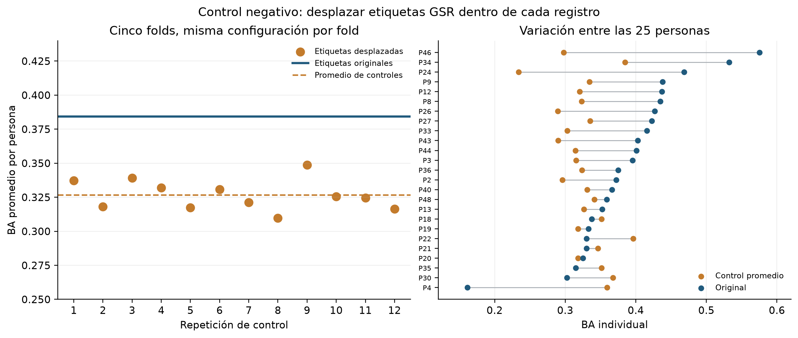

# Control negativo temporal y análisis de errores — 24-10-2026

## Diseño ejecutado

Se siguió el [protocolo](Protocolo_Control_Negativo_Temporal_24-10-2026.md) en las 13.524 ventanas de 25 participantes de train. Se reprodujeron primero las cinco predicciones fuera de fold del Ridge sin `fixation_count`: las probabilidades coincidieron con los artefactos originales. En cada uno de 12 controles se desplazó circularmente la pseudoetiqueta GSR 6 s de cada persona **solo en el conjunto de ajuste** por al menos 120 ventanas, conservando exactamente las frecuencias de clases. Las entradas del Modelo Estudiante permanecieron fijas y sin GSR. Se mantuvieron la representación y el suavizado elegidos previamente para cada fold. Se reentrenaron 65 modelos en total: cinco de reproducción y 60 controles.

El primer intento de automatización se detuvo antes de entrenar controles porque asumía erróneamente que los cinco folds tenían la misma representación. El catálogo original usa `current/32`, `multiscale/8`, `delayed4/32`, `multiscale/8` y `relative/1`. El manifiesto abortado se conservó como `protocolo_intento_invalido.json`, y el protocolo ejecutado registra la corrección.

## Resultado del control

| Medida, BA macro por persona | Resultado |
|---|---:|
| Etiquetas originales, predicción fuera de fold | **0,3843** |
| Promedio de 12 controles desplazados | **0,3268** |
| Rango de controles | 0,3097–0,3488 |
| Diferencia original menos promedio de controles | **+5,76 puntos porcentuales** |
| Intervalo bootstrap descriptivo de la diferencia entre personas | [+1,85; +9,58] puntos |
| Personas con resultado original sobre su control promedio | 19 de 25 |
| Controles que alcanzaron el resultado original | 0 de 12 |

El contraste indica que, **en train y para esta pseudoetiqueta**, conservar la alineación temporal entre las entradas y GSR mejora la predicción frente a estos desplazamientos. Hay heterogeneidad: seis participantes no superan su control promedio; P4 tiene BA original 0,1612 y control promedio 0,3593. La diferencia entre personas es descriptiva, no una prueba confirmatoria.

El control conserva la distribución y gran parte de la continuidad de cada etiqueta, pero desplazarla a lo largo del registro puede cambiar su relación con el estímulo y otras tendencias de sesión. Además, la variante Ridge y los parámetros de cada fold habían sido elegidos usando las etiquetas originales de train. Por eso **0 de 12 controles superiores no equivale a un valor p confirmatorio** y la diferencia puede favorecer al modelo original. El experimento comprueba dependencia de alineación con la pseudoetiqueta; no valida que esta represente activación psicológica ni demuestra una mejora en personas nuevas.

## Dónde se equivoca el modelo

El análisis de errores utiliza las predicciones originales guardadas: fuera de fold en train y ensamble fijo en los ocho participantes de test previamente consultados. La BA macro por persona test fue 0,3557; la BA global por ventana fue 0,3338. El recall de la clase `medio` en test fue **21,8 %** (251 de 1.154 ventanas), frente a 31,2 % para `bajo` y 47,2 % para `alto`. El modelo predijo `alto` en 1.738 ventanas, aunque esa clase era la referencia en 1.173. Estas cifras describen errores, sin usar test para cambiar el modelo.

En test, la BA por persona varió de **0,2211 a 0,4596**. P37 solo tiene dos clases presentes; su BA promedia esas dos. La tabla completa por persona y la matriz de confusión están en `resultados/diagnostico_errores_24-10-2026/`.

Los cuatro estímulos nominales que aparecen en las 33 personas se eligieron por cobertura antes de mirar su rendimiento:

| Estímulo | Personas test | Ventanas test | BA global train | BA global test | Recall `medio` test |
|---|---:|---:|---:|---:|---:|
| Meg | 8 | 258 | 0,3288 | 0,2343 | 0,0 % |
| diario_financiero | 8 | 252 | 0,4712 | 0,2931 | 4,9 % |
| temu | 8 | 253 | 0,3308 | 0,3300 | 8,3 % |
| Despega | 8 | 243 | 0,3766 | 0,2169 | 11,1 % |

La BA por estímulo agrupa ventanas y no da igual peso a las personas. Además, duración, orden y distribución de clases pueden confundirse con el estímulo; la tabla no demuestra efectos causales ni permite elegir un estímulo favorable. Se conservaron estadísticas de **todos** los estímulos, junto con tamaños y clases presentes, en `errores_estimulos.csv`.

## Lectura para la tesis

> Un control negativo temporal con 12 desplazamientos circulares de la pseudoetiqueta GSR por participante produjo BA macro por persona 0,327 en promedio, frente a 0,384 con la alineación original. El resultado original superó las 12 realizaciones de control y 19 de 25 participantes superaron su propio control promedio. Esto es consistente con una dependencia de la alineación temporal para predecir la pseudoetiqueta en la muestra de entrenamiento. Sin embargo, la selección previa del modelo, la heterogeneidad individual, la BA test cercana a una referencia trivial y la ausencia de una medida externa impiden concluir que se detecte activación psicológica o que la ventaja se generalice.

## Reproducción y auditoría

`python scripts/control_negativo_temporal_24_10_2026.py` reproduce el contraste y guarda predicciones, 1.200 desplazamientos, métricas por persona y hashes. `python scripts/diagnosticar_errores_24_10_2026.py` genera tablas por persona, estímulo y confusión; `python scripts/graficar_control_negativo_24_10_2026.py` produce PNG/PDF. Se comprobaron 13.524 predicciones limpias, 162.288 predicciones de control y los límites de los 1.200 desplazamientos; los cinco folds limpios reprodujeron las probabilidades antiguas con tolerancia `1e-10`. Validation, test y P29 no intervinieron en los ajustes del control. El diagnóstico de test reutiliza el test ya consultado.
