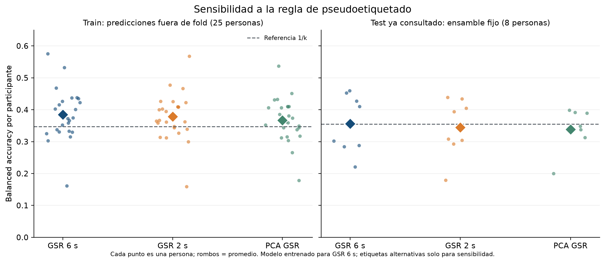

# Robustez del resultado sin cohorte nueva — 24-10-2026

## Resumen

Se aplicó el [protocolo fijado](Protocolo_Robustez_Sin_Cohorte_Nueva_24-10-2026.md) a predicciones ya guardadas, sin reentrenar modelos ni elegir umbrales. El Ridge sin `fixation_count` fue entrenado para la pseudoetiqueta de activación GSR de 6 s. En train se usaron predicciones fuera de fold de 25 participantes (13.524 ventanas); en test, el ensamble fijo de cinco Ridge sobre ocho participantes (4.025 ventanas). Test ya había sido consultado en investigaciones anteriores. Validation y P29 no se usaron.

**Hallazgo principal:** la BA promedio por participante en test fue **0,3557**, prácticamente igual a la referencia aritmética media **0,3542** de un clasificador constante que acierta una de las clases presentes en cada participante (`1/k`). Solo cuatro de ocho personas superaron su referencia `1/k`; su BA individual varió de 0,2211 a 0,4596. La comparación `1/k` es una referencia matemática, no un clasificador desplegable que conozca de antemano las clases presentes de cada persona. En esta muestra no se observa una ventaja clara frente a esa referencia, ni se obtiene una confirmación independiente nueva.

## Variación entre participantes y reglas de etiqueta

| Partición y referencia | Ventanas | BA macro por persona | Rango individual | Referencia media `1/k` | Personas sobre `1/k` |
|---|---:|---:|---:|---:|---:|
| Train, GSR 6 s | 13.524 | 0,3843 | 0,1612–0,5753 | 0,3467 | 18/25 |
| Train, GSR 2 s | 13.524 | 0,3786 | 0,1590–0,5680 | 0,3467 | 19/25 |
| Train, PCA GSR | 13.124 | 0,3670 | 0,1786–0,5372 | 0,3400 | 19/25 |
| Test, GSR 6 s | 4.025 | 0,3557 | 0,2211–0,4596 | 0,3542 | 4/8 |
| Test, GSR 2 s | 4.025 | 0,3444 | 0,1794–0,4389 | 0,3542 | 4/8 |
| Test, PCA GSR | 4.025 | 0,3386 | 0,2000–0,3988 | 0,3542 | 5/8 |

El intervalo bootstrap descriptivo de BA por participante para GSR 6 s fue [0,3525; 0,4151] en train y [0,2976; 0,4112] en test (5.000 remuestreos de personas). P37 solo tiene dos clases presentes en test; según el protocolo, su BA individual promedia esas dos clases. Por eso la referencia `1/k` media en test es ligeramente mayor que 1/3.

## Cambios de pseudoetiqueta con predicciones fijas

| Partición | Regla alternativa | Acuerdo con GSR 6 s | Ventanas que cambian | Diferencia pareada BA (alternativa − 6 s) | Intervalo descriptivo de diferencia |
|---|---|---:|---:|---:|---:|
| Train | GSR 2 s | 81,95 % | 2.441 / 13.524 | −0,57 pp | [−1,41; +0,35] pp |
| Train | PCA GSR | 66,97 % | 4.335 / 13.124 | −1,51 pp | [−3,32; +0,30] pp |
| Test | GSR 2 s | 80,32 % | 792 / 4.025 | −1,13 pp | [−2,42; +0,20] pp |
| Test | PCA GSR | 69,47 % | 1.229 / 4.025 | −1,71 pp | [−4,75; +1,31] pp |

Para PCA se compararon solo ventanas con ambas etiquetas: la cobertura fue 97,04 % en train y 100 % en test. La BA GSR 6 s se recalculó en ese soporte común antes de restarla. Las matrices de transición y métricas pareadas por persona están en `resultados/robustez_sin_cohorte_nueva_24-10-2026/`.

Las diferencias de BA son pequeñas frente a la variación entre participantes y todos los intervalos descriptivos de diferencias incluyen cero. El descenso al usar otra etiqueta **no prueba que GSR 6 s sea mejor definición del constructo**: el Modelo Estudiante fue entrenado precisamente para GSR 6 s. El análisis mide sensibilidad de las predicciones fijas ante objetivos alternativos. No se modificó ninguna pseudoetiqueta ni decisión científica abierta.

## Lectura para la tesis

> Con predicciones fijadas previamente, la BA macro por participante para la pseudoetiqueta principal de activación fue 0,384 en las 25 personas de train mediante validación cruzada y 0,356 en ocho personas de test ya consultadas. En test, cuatro de ocho personas superaron la referencia aritmética `1/k`. Cambiar la ventana del Modelo Profesor de GSR de 6 a 2 s modificó 19,7 % de las pseudoetiquetas de test y redujo descriptivamente la BA en 1,13 puntos porcentuales; la variante PCA modificó 30,5 % y redujo la BA en 1,71 puntos. Los intervalos descriptivos de ambas diferencias incluyen cero. Estos resultados muestran heterogeneidad entre personas y dependencia de la definición del objetivo; no permiten concluir detección de activación psicológica ni confirmar una mejora independiente.

Los intervalos remuestrean participantes y no ventanas solapadas. La selección previa de modelos sobre train, el uso anterior de test, la falta de una medida externa de activación y la normalización de etiquetas con la sesión completa limitan cualquier inferencia causal o prospectiva. El acuerdo entre variantes que comparten GSR es consistencia interna, no validez de constructo. Para atención, la auditoría previa encontró solo 48,9 % de acuerdo entre fusión igualitaria y PCA; no se extrapola el análisis de rendimiento de activación a ese objetivo.

En la construcción original de `arousal_label_pca`, el PCA se ajustó con train, pero el signo del componente se orientó por su correlación con la referencia usando todas las filas completas del dataset. Por eso la variante PCA tampoco puede tratarse como una referencia de test definida con ceguera estricta. Esta auditoría no cambia esa etiqueta heredada; deja registrada la limitación.

## Reproducción

`python scripts/robustez_sin_cohorte_nueva_24_10_2026.py` genera `protocolo.json`, `resumen.json`, tablas por persona y transiciones. `python scripts/graficar_robustez_24_10_2026.py` genera la figura PNG/PDF. El manifiesto registra SHA-256 de datos, partición, protocolo y predicciones. La auditoría independiente de los 4.025 registros de test reprodujo las tres BA (0,355666; 0,344387; 0,338586) y los cambios de etiqueta (792 y 1.229 ventanas).
