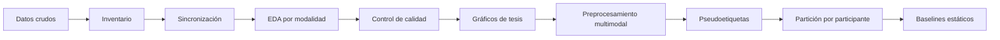

# Mapa del proyecto MDS

> [!abstract] Punto de entrada
> MOC del análisis de EEG, GSR, pupilometría y eye tracking: sincronización, EDA,
> preprocesamiento, etiquetas y baselines. Fusiona las antiguas `Inicio MDS`,
> `README` y `Datos/README`, que dejaron de existir como notas separadas el 24-08-2026.
>
> **El código y los datos no viven aquí.** Están en el repositorio
> `~/tesis/Tesis_MDS`. Estas
> notas son la documentación sincronizada al 22-08-2026; los `.py` y `.csv` que se citan
> se nombran en `código` porque están fuera del vault.

Proyecto con EEG, GSR, pupilometría y eye tracking, sus manifiestos de sincronización y
análisis exploratorios reproducibles. Contexto y diseño en [[Tesis_MDS]].

## Recorrido recomendado

1. [[DOCUMENTACION_DATOS_MDS|Fuentes de datos]] — estructura y diccionario
2. [[SINCRONIZACION_SENALES|Sincronización]] — coordinación EEG–Tobii, offsets y límites
3. [[EDA_SENALES|EDA por señal]] — índice de las cuatro modalidades
4. [[PREPROCESAMIENTO_MULTIMODAL|Preprocesamiento]] — protocolo, features y reproducción
5. [[ETIQUETAS_Y_BASELINES|Etiquetas y baselines]] — pseudoetiquetas, partición, fuera de muestra
6. [[GRAFICOS_TESIS|Gráficos de tesis]] — figuras finales
7. [[RESUMEN_PROCESO|Resumen de todo lo realizado]]

## Flujo



## Señales

| Señal | Nota | Resultado |
|---|---|---|
| EEG | [[EDA_EEG\|EDA EEG]] | 44/48 utilizables |
| GSR | [[EDA_GSR\|EDA GSR]] | 47/49 disponibles |
| Pupilometría | [[EDA_EYE_PUPIL#Pupilometría\|EDA pupilar]] | 90,25 % válido |
| Eye tracking | [[EDA_EYE_PUPIL#Eye tracking\|EDA de mirada]] | 94,98 % válido |

## Calidad por fuente

*Actualizado al 22-08-2026.*

| Fuente | Criterio | Utilizable/válido |
|---|---|---:|
| EEG | Sesiones principales con saturación y repetición plana ≤30 % | 44/48 = **91,67 %** |
| GSR | Grabaciones con señal correcta sobre las 49 Tobii | 47/49 = **95,92 %** |
| Pupilometría | Ambos ojos válidos simultáneamente | **90,25 %** de muestras |
| Eye tracking | Punto de mirada válido | **94,98 %** de muestras |

En EEG se excluyen P1, P14, P17 y P25. P25 se identificó al corregir la selección de
sesiones con varios TXT: se usa el archivo más largo, evitando fragmentos de arranque. La
regla es útil para exploración tolerante al ruido, pero los casos cercanos al umbral deben
seguir marcados como baja calidad para análisis confirmatorios. Detalle en
[[Avance - 22-08-2026 (Pipeline Multimodal Reproducible)]].

## Resumen de lo realizado

1. Se inventariaron el TSV Tobii/GSR y las 104 sesiones OpenBCI del ZIP.
2. Se reconstruyó un dominio UTC común y se emparejaron sesiones por participante y proximidad temporal.
3. No se estimó drift sin triggers compartidos; `drift_scale=1.0` significa que no existe una corrección identificable.
4. Se ejecutaron EDA independientes para EEG, GSR, pupilometría y eye tracking.
5. Se implementó y ejecutó un preprocesamiento multimodal secuencial sobre ventanas UTC comunes.
6. Se fijaron configuración, dependencias, pruebas, hashes y auditoría para reproducirlo.
7. Se adoptó un criterio EEG exploratorio flexible: utilizable si saturación y repetición plana son ≤30 %.
8. Se congeló una partición por participante y se ejecutaron baselines estáticos para atención y activación.

## Datos crudos locales

Los originales **no se versionan y no están en el vault**. En el repositorio se colocan en
`datos/`:

- `Toma_muestras_v2 Data export.tsv`
- `eeg_recordings_exp_V2.zip`

No se suben a GitHub por su tamaño. Los scripts esperan esas rutas por defecto y procesan
el TSV por streaming y el ZIP sin extracción permanente. Las fuentes originales se obtienen
desde el almacenamiento autorizado del proyecto; no se incluyen datos sensibles o
identificables en Git.

## Ejecución

Desde la raíz del repositorio `~/tesis/Tesis_MDS`.
La ejecución completa es estrictamente
secuencial:

```powershell
python -m pip install -r requirements.txt
python -m unittest discover -s tests -v
python .\scripts\ejecutar_todo.py
```

Todos los scripts procesan los archivos grandes por streaming o directamente dentro del ZIP.

## Código

Scripts del repositorio, fuera del vault: `sincronizar_senales.py`, `eda_eeg.py`,
`eda_gsr.py`, `eda_eye_pupil.py`, `graficos_tesis.py`, `ejecutar_todo.py`,
`preprocesamiento_secuencial.py`, `preparar_modelado.py`, `baselines_estaticos.py`.

Tablas de resultados: `resumen_calidad_fuentes.csv`, `coordinacion_sesiones.csv`,
`auditoria_participantes.csv`, `particion_participantes.csv`, `metricas_baselines.csv`.

Notebook original de referencia: `Sincronizacion señales.ipynb`.

## Figuras

Las 16 figuras generadas por el pipeline están en
`01 Tesis MDS/attachments/Analisis de Datos/`.

## Infraestructura

- [[Librerias|Librerías del clúster]]

## Precauciones

- No mezclar sesiones `test` con principales sin justificarlo.
- Revisar P29 por offset y `Test_Participant` por falta de correspondencia.
- P7 y P42 no tienen GSR.
- Mantener las frecuencias nativas y recortar epochs mediante timestamps comunes.
- Una sincronización submuestra requiere triggers observables en ambos dispositivos.

## Notas relacionadas

- [[Tesis_MDS]] — índice de la sección
- [[Avance - 22-08-2026 (Pipeline Multimodal Reproducible)]]
- [[Avance - 22-08-2026 (Etiquetas Particion y Baselines)]]
