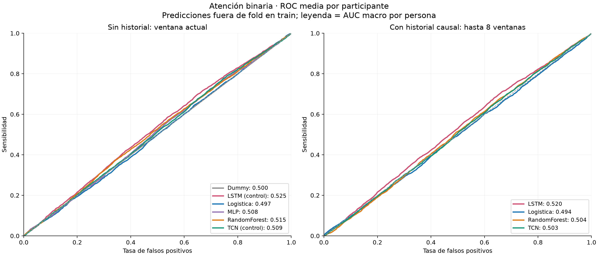
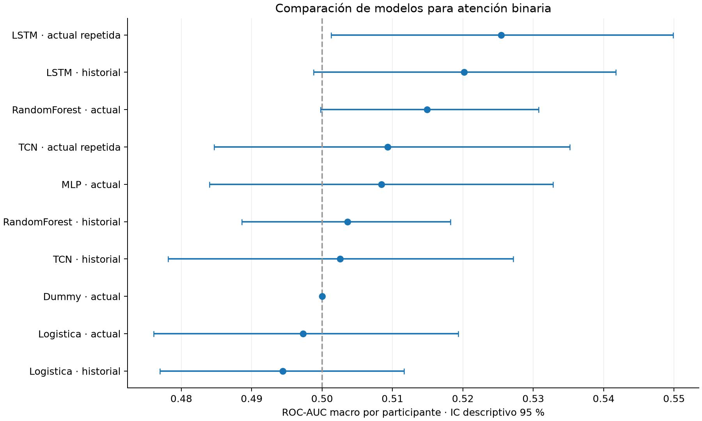

# Atención binaria — 29-10-2026

Definición: 1 = alta; 0 = media/baja

Entradas: EEG y GSR; mirada/pupila excluidas porque generan la pseudoetiqueta. Cinco folds originales de atención por participante, solo train. Predicciones de dos semillas promediadas en redes; hiperparámetros y ocho épocas fijados antes de evaluar. Historial: hasta ocho ventanas consecutivas, reiniciado en cambios de segmento o huecos; incluye la ventana actual. Las ventanas duran 2 s y avanzan 1 s: cobertura máxima 9 s.

| Modelo | Entrada | AUC macro | IC descriptivo 95 % | AUC agrupada |
|---|---|---:|---:|---:|
| LSTM | actual repetida | 0.5255 | [0.5013, 0.5499] | 0.5206 |
| LSTM | historial | 0.5202 | [0.4988, 0.5417] | 0.5140 |
| RandomForest | actual | 0.5149 | [0.4998, 0.5308] | 0.5148 |
| TCN | actual repetida | 0.5093 | [0.4846, 0.5352] | 0.5033 |
| MLP_current | actual | 0.5084 | [0.4840, 0.5328] | 0.5060 |
| RandomForest | historial | 0.5036 | [0.4886, 0.5182] | 0.5029 |
| TCN | historial | 0.5026 | [0.4781, 0.5272] | 0.4979 |
| Dummy | actual | 0.5000 | [0.5000, 0.5000] | 0.4998 |
| Logistica | actual | 0.4973 | [0.4761, 0.5193] | 0.4984 |
| Logistica | historial | 0.4944 | [0.4770, 0.5116] | 0.4967 |

## Efecto pareado del historial

- Logistica: ΔAUC -0.0029, IC [-0.0194, +0.0132].
- RandomForest: ΔAUC -0.0113, IC [-0.0209, -0.0015].
- TCN: ΔAUC -0.0068, IC [-0.0132, -0.0003].
- LSTM: ΔAUC -0.0053, IC [-0.0119, +0.0011].

Las curvas promedian ROC por persona; el AUC principal promedia AUC individuales (no el área numérica de la curva interpolada). Los intervalos remuestrean participantes, no ventanas. Personas con una sola clase se excluyen de AUC y se cuentan en metricas.csv. El control temporal repite la ventana actual conservando arquitectura y longitud disponible. Logística/RF con historial reciben actual, media, desviación y cambio respecto a la primera ventana. Umbral 0,5 solo para BA; AUC usa puntuaciones continuas. No se seleccionaron umbrales con evaluación externa.

Resultado exploratorio sobre train ya reutilizado en estudios anteriores. La nueva tarea binaria no se compara directamente con la BA ternaria. No demuestra atención psicológica validada ni mejora confirmatoria en personas nuevas. Validation, test y P29 no se evaluaron. Preprocesamiento previo y pseudoetiquetas offline conservan las limitaciones del dataset original.

Auditoría adicional: 202.860 predicciones cotejadas con sus etiquetas y participantes de origen; folds sin participantes compartidos, hashes y AUC recalculadas. Ejecutar `python scripts/auditar_atencion_binaria.py`. Etiquetas binarias de train exportadas en `etiquetas_binarias_train.csv.gz`.
