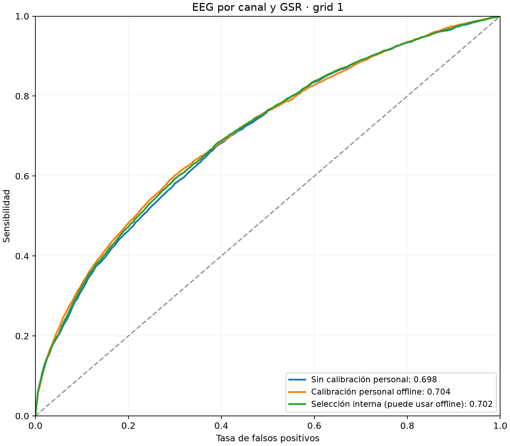

# EEG por canal y GSR — grid 1

Etiquetas y personas fijas del profesor PCA reconstruido. ROC-AUC principal = promedio por persona de predicciones OOF. Selección de parámetros solo en el holdout interno agrupado (16 personas ajuste, 4 selección); cada fold externo evalúa cinco personas distintas.

| Estrategia | AUC macro | IC descriptivo 95 % | ΔAUC frente a 0,6464 | IC de Δ |
|---|---:|---:|---:|---:|
| Sin calibración personal | 0.6982 | [0.6776; 0.7181] | +0.0518 | [+0.0385; +0.0638] |
| Calibración personal offline | 0.7037 | [0.6865; 0.7216] | +0.0573 | [+0.0405; +0.0730] |
| Selección interna (puede usar offline) | 0.7021 | [0.6835; 0.7211] | +0.0557 | [+0.0424; +0.0680] |

Se agregan variables EEG por canal, potencia Welch, entropía, Hjorth y calidad calculadas desde el ZIP V2 verificado. Se conservan exactamente las ventanas, etiquetas y folds de los análisis anteriores. Los canales inválidos producen features ausentes sin eliminar ventanas; la imputación se ajusta dentro de cada fold. El historial agrega medias de potencias relativas por canal y del panel EEG/GSR anterior, además de desviaciones del panel anterior. La estrategia inductiva ajusta imputación y escalado únicamente con personas de entrenamiento. La estrategia relativo_offline calcula media y desviación de EEG/GSR usando la sesión completa no etiquetada de cada persona, también de evaluación. Es adaptación transductiva offline; no representa un detector online ni una comparación idéntica de preprocesamiento con la referencia. La fila selección interna escoge entre ambas estrategias usando solo score interno.

Entradas: solo EEG/GSR y sus transformaciones logarítmicas y resúmenes temporales. Se excluyen mirada, pupila, scores, etiquetas, identidad y tiempo de sesión como predictores. Los scores docentes siguen siendo relativos y offline. Historial reiniciado en cambios de segmento/huecos. Las configuraciones completas constan en protocolo.json y selecciones.csv.

Búsqueda adaptativa sobre train reutilizado: intervalos descriptivos por bootstrap de personas, sin corrección por búsqueda acumulada ni parada al alcanzar una meta. Test/validation/P29 sin evaluar. AUC mayor que 0,70 aquí, si ocurre, no equivale a generalización confirmada. No se cambia la definición de etiqueta ni la métrica para alcanzar la meta.

[Predicciones](predicciones_oof.csv.gz) · [Selecciones](selecciones.csv) · [Protocolo](protocolo.json)