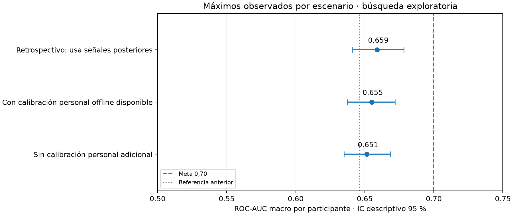
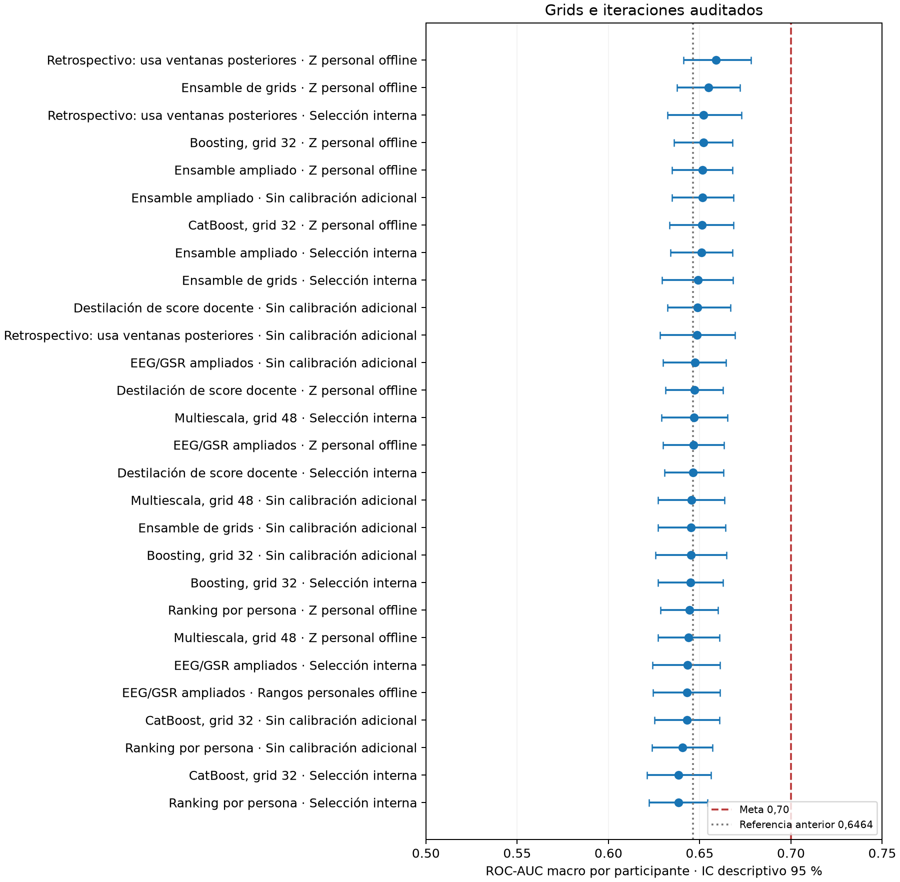

# Grid e iteraciones de atención binaria — 29-10-2026

Búsqueda completada: **1.000 ajustes internos únicos y 75 modelos externos**, con todos los resultados y auditorías guardados. **La meta 0,70 no se alcanzó.** Mejor resultado sin entradas futuras y sin calibración personal adicional: ensamble ampliado, AUC 0,6515. Mejor variante con calibración personal offline y sin entradas futuras: ensamble boosting/CatBoost, AUC 0,6549. Máximo de todos los escenarios: retrospectivo con señales posteriores y calibración offline, AUC 0,6590, IC descriptivo [0,6412; 0,6782].

El ensamble offline sin señales futuras mejora descriptivamente la referencia 0,6464 en +0,0085, con intervalo de diferencia [-0,0034; +0,0192]; no confirma una mejora estable. La búsqueda se estancó cerca de 0,65–0,66 en estas representaciones. Esto no prueba un límite matemático de los datos ni garantiza que otro modelo no pueda mejorar, pero las rondas ejecutadas no aportaron un resultado sobre 0,70.

Para ampliar el trabajo desde la señal, faltan los registros crudos: este mini dispone de las características procesadas versionadas, y no se encontraron registros EDF/BDF/XDF/TSV de señales en Documentos, Descargas o Escritorio durante esta revisión. Su ubicación en otro equipo, disco o nube quedó consultada al usuario; no se afirma que no existan fuera de esas carpetas.

Meta solicitada: ROC-AUC promedio por persona mayor que 0,70. Solo se considera alcanzada con las predicciones OOF completas y auditadas de las 25 personas; no con una métrica interna, un participante favorable, el conjunto de entrenamiento ni un cambio de etiqueta.

**Estado de la meta: todavía no alcanzada.**

| Corrida | Escenario | ROC-AUC | IC descriptivo 95 % | Δ frente a 0,6464 |
|---|---|---:|---:|---:|
| Boosting, grid 32 | Sin calibración adicional | 0.6451 | [0.6257; 0.6645] | -0.0013 |
| Boosting, grid 32 | Z personal offline | 0.6520 | [0.6359; 0.6679] | +0.0055 |
| Boosting, grid 32 | Selección interna | 0.6450 | [0.6272; 0.6628] | -0.0014 |
| CatBoost, grid 32 | Sin calibración adicional | 0.6429 | [0.6253; 0.6608] | -0.0035 |
| CatBoost, grid 32 | Z personal offline | 0.6511 | [0.6335; 0.6685] | +0.0047 |
| CatBoost, grid 32 | Selección interna | 0.6384 | [0.6211; 0.6561] | -0.0080 |
| Ensamble de grids | Sin calibración adicional | 0.6452 | [0.6272; 0.6642] | -0.0012 |
| Ensamble de grids | Z personal offline | 0.6549 | [0.6375; 0.6720] | +0.0085 |
| Ensamble de grids | Selección interna | 0.6491 | [0.6293; 0.6681] | +0.0027 |
| Multiescala, grid 48 | Sin calibración adicional | 0.6456 | [0.6271; 0.6637] | -0.0008 |
| Multiescala, grid 48 | Z personal offline | 0.6437 | [0.6270; 0.6608] | -0.0027 |
| Multiescala, grid 48 | Selección interna | 0.6470 | [0.6291; 0.6652] | +0.0006 |
| EEG/GSR ampliados | Sin calibración adicional | 0.6474 | [0.6299; 0.6643] | +0.0009 |
| EEG/GSR ampliados | Z personal offline | 0.6465 | [0.6299; 0.6634] | +0.0001 |
| EEG/GSR ampliados | Rangos personales offline | 0.6431 | [0.6243; 0.6610] | -0.0033 |
| EEG/GSR ampliados | Selección interna | 0.6434 | [0.6241; 0.6612] | -0.0030 |
| Retrospectivo: usa ventanas posteriores | Sin calibración adicional | 0.6485 | [0.6283; 0.6693] | +0.0021 |
| Retrospectivo: usa ventanas posteriores | Z personal offline | 0.6590 | [0.6412; 0.6782] | +0.0126 |
| Retrospectivo: usa ventanas posteriores | Selección interna | 0.6520 | [0.6324; 0.6729] | +0.0056 |
| Destilación de score docente | Sin calibración adicional | 0.6487 | [0.6324; 0.6668] | +0.0023 |
| Destilación de score docente | Z personal offline | 0.6471 | [0.6313; 0.6628] | +0.0007 |
| Destilación de score docente | Selección interna | 0.6463 | [0.6307; 0.6630] | -0.0001 |
| Ranking por persona | Sin calibración adicional | 0.6405 | [0.6238; 0.6570] | -0.0059 |
| Ranking por persona | Z personal offline | 0.6445 | [0.6285; 0.6599] | -0.0019 |
| Ranking por persona | Selección interna | 0.6384 | [0.6223; 0.6544] | -0.0080 |
| Ensamble ampliado | Sin calibración adicional | 0.6515 | [0.6349; 0.6685] | +0.0051 |
| Ensamble ampliado | Z personal offline | 0.6515 | [0.6349; 0.6680] | +0.0051 |
| Ensamble ampliado | Selección interna | 0.6509 | [0.6341; 0.6679] | +0.0045 |

Las variantes de normalización y rangos personales requieren toda la sesión no etiquetada y se reportan como adaptación transductiva offline. El historial de variables es causal, pero esa calibración no lo es. El profesor también conserva su definición relativa offline. Ninguno de estos escenarios valida por sí mismo la atención psicológica ni la generalización futura.

El contraste retrospectivo usa ventanas posteriores explícitamente. Sus resultados se presentan por separado: no constituyen una mejora de detección causal en tiempo real. Se conservan las etiquetas del profesor PCA y los mismos cinco folds de personas. Los parámetros y los pesos de mezcla se eligen con cuatro personas internas, usando 16 para ajuste; luego se reajusta en 20 y evalúa en cinco personas externas por fold. Test/validation/P29 sin evaluar. Los intervalos remuestrean personas, no ventanas. Son descriptivos y no corrigen búsqueda reiterada ni la parada al alcanzar una meta.

## Estado de las corridas

- Boosting, grid 32: completa y auditada; 160 ajustes internos guardados, 10 modelos externos. [Carpeta](ronda1/).
- CatBoost, grid 32: completa y auditada; 160 ajustes internos guardados, 10 modelos externos. [Carpeta](ronda2/).
- Ensamble de grids: completa y auditada; 0 ajustes internos guardados, 0 modelos externos. [Carpeta](ensamble_rondas12/).
- Multiescala, grid 48: completa y auditada; 240 ajustes internos guardados, 10 modelos externos. [Carpeta](ronda3/).
- EEG/GSR ampliados: completa y auditada; 120 ajustes internos guardados, 15 modelos externos. [Carpeta](caracteristicas_ampliadas/ronda1/).
- Retrospectivo: usa ventanas posteriores: completa y auditada; 120 ajustes internos guardados, 10 modelos externos. [Carpeta](retrospectivo/ronda1/).
- Destilación de score docente: completa y auditada; 120 ajustes internos guardados, 10 modelos externos. [Carpeta](destilacion/ronda1/).
- Ranking por persona: completa y auditada; 80 ajustes internos guardados, 10 modelos externos. [Carpeta](ranking/ronda1/).
- Ensamble ampliado: completa y auditada; 0 ajustes internos guardados, 0 modelos externos. [Carpeta](ensamble_ampliado/).

Los registros parciales se conservan; no se presentan como una evaluación completa. La ronda 1 tuvo una interrupción al guardar metadatos de selección, corregida sin cambiar datos, modelos o grid; protocolo original y corrección quedan registrados.

## Fuentes y reproducción

- [Grid original](../../scripts/grid_atencion_meta07.py)
- [Ensamble](../../scripts/ensamblar_grid_atencion_meta07.py)
- [Grid con características ampliadas](../../scripts/grid_atencion_caracteristicas_ampliadas.py)
- [Comparación CSV](comparacion_rondas_auditadas.csv)
- [Estado estructurado](estado_busqueda.json)

