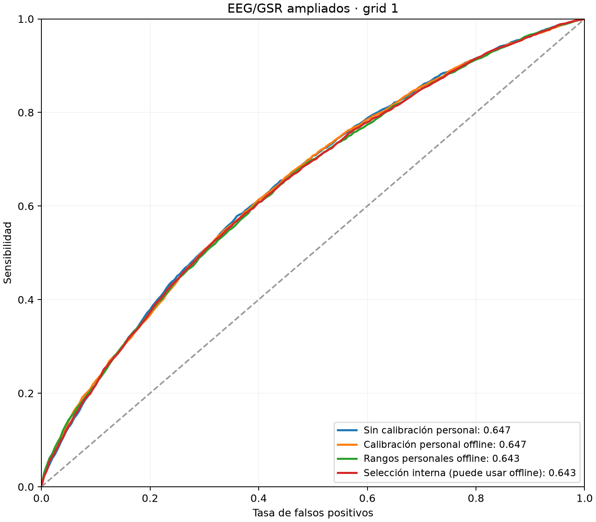

# Grid atención binaria PCA — ronda 1

Etiquetas y personas fijas del profesor PCA reconstruido. ROC-AUC principal = promedio por persona de predicciones OOF. Selección de parámetros solo en el holdout interno agrupado (16 personas ajuste, 4 selección); cada fold externo evalúa cinco personas distintas.

| Estrategia | AUC macro | IC descriptivo 95 % | ΔAUC frente a 0,6464 | IC de Δ |
|---|---:|---:|---:|---:|
| Sin calibración personal | 0.6474 | [0.6299; 0.6643] | +0.0009 | [-0.0073; +0.0092] |
| Calibración personal offline | 0.6465 | [0.6299; 0.6634] | +0.0001 | [-0.0121; +0.0115] |
| Rangos personales offline | 0.6431 | [0.6243; 0.6610] | -0.0033 | [-0.0174; +0.0088] |
| Selección interna (puede usar offline) | 0.6434 | [0.6241; 0.6612] | -0.0030 | [-0.0146; +0.0078] |

La estrategia inductiva ajusta imputación y escalado únicamente con personas de entrenamiento. La estrategia relativo_offline calcula media y desviación de EEG/GSR usando la sesión completa no etiquetada de cada persona, también de evaluación. Es adaptación transductiva offline; no representa un detector online ni una comparación idéntica de preprocesamiento con la referencia. Rangos offline transforma cada variable con el rango percentil personal y una función normal inversa, usando la sesión completa sin etiquetas. Es otro escenario transductivo offline. Se añaden calidad/cobertura EEG/GSR y cuatro razones espectrales EEG calculadas sin etiquetas. La fila selección interna escoge entre ambas estrategias usando solo score interno.

Entradas: solo EEG/GSR y sus transformaciones logarítmicas y resúmenes temporales. Se excluyen mirada, pupila, scores, etiquetas, identidad y tiempo de sesión como predictores. Los scores docentes siguen siendo relativos y offline. Historial reiniciado en cambios de segmento/huecos. Las configuraciones completas constan en protocolo.json y selecciones.csv.

Búsqueda adaptativa sobre train reutilizado: intervalos descriptivos por bootstrap de personas, sin corrección por búsqueda acumulada ni parada al alcanzar una meta. Test/validation/P29 sin evaluar. AUC mayor que 0,70 aquí, si ocurre, no equivale a generalización confirmada. No se cambia la definición de etiqueta ni la métrica para alcanzar la meta.

[Predicciones](predicciones_oof.csv.gz) · [Selecciones](selecciones.csv) · [Protocolo](protocolo.json)