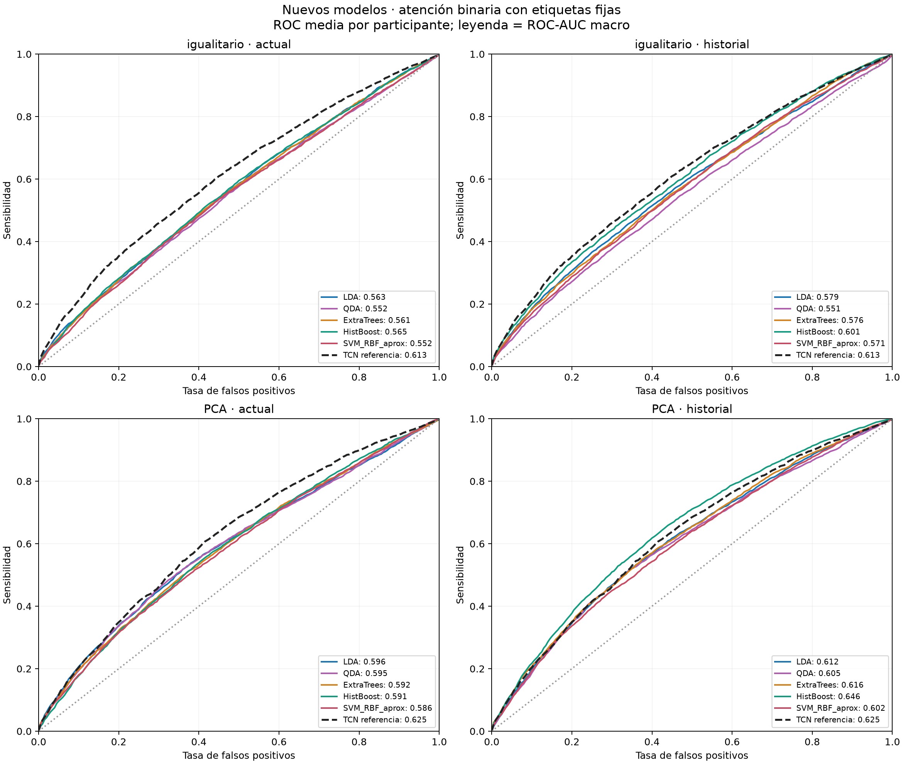

# Nuevos modelos de atención binaria — 29-10-2026

Resultado principal: con profesor PCA, HistGradientBoosting con historial obtuvo AUC macro 0,6464 (IC descriptivo 95 % [0,6281; 0,6641]), frente a 0,6254 de la referencia TCN anterior. Diferencia pareada +0,0210 [0,0080; 0,0337], con 18/25 personas que mejoran. La estrategia que selecciona familia y representación internamente obtuvo 0,6416, diferencia +0,0161 [0,0029; 0,0286].

El aporte de historial dentro de boosting PCA fue +0,0550 de AUC (de 0,5915 a 0,6464). Con profesor igualitario, el mejor nuevo fue boosting con historial (0,6007), sin superar TCN anterior (0,6127).

Auditoría adicional aprobada: 100 modelos externos recargados, 200 internos verificados y 296.956 filas de predicción cotejadas con las etiquetas originales de esta tarea; AUC recalculadas. Este total incluye 26.996 filas reutilizadas por la estrategia de selección interna, no predicciones de modelos adicionales.

Se conservan exactamente las etiquetas binarias reconstruidas y los folds externos de la corrida anterior. Solo train original; validation, test y P29 no se evalúan. Cinco familias nuevas × dos representaciones × dos profesores × cinco folds: 100 modelos externos y 200 ajustes internos. Parámetros escogidos por AUC macro en cuatro personas de validación interna, usando 16 personas para ajuste interno. PCA docente reajustado únicamente con personas del ajuste interno al seleccionar parámetros; en evaluación externa se conserva el profesor de fold anterior.

| Profesor | Modelo | Entrada | AUC macro | IC descriptivo 95 % |
|---|---|---|---:|---:|
| igualitario | HistBoost | history | 0.6007 | [0.5784; 0.6224] |
| igualitario | Seleccion_interna | selected | 0.5927 | [0.5693; 0.6145] |
| igualitario | LDA | history | 0.5789 | [0.5580; 0.5978] |
| igualitario | ExtraTrees | history | 0.5763 | [0.5510; 0.6002] |
| igualitario | SVM_RBF_aprox | history | 0.5709 | [0.5503; 0.5907] |
| igualitario | HistBoost | current | 0.5651 | [0.5406; 0.5890] |
| igualitario | LDA | current | 0.5630 | [0.5364; 0.5877] |
| igualitario | ExtraTrees | current | 0.5612 | [0.5355; 0.5862] |
| igualitario | QDA | current | 0.5522 | [0.5273; 0.5774] |
| igualitario | SVM_RBF_aprox | current | 0.5521 | [0.5259; 0.5783] |
| igualitario | QDA | history | 0.5513 | [0.5306; 0.5727] |
| pca | HistBoost | history | 0.6464 | [0.6281; 0.6641] |
| pca | Seleccion_interna | selected | 0.6416 | [0.6243; 0.6596] |
| pca | ExtraTrees | history | 0.6165 | [0.5997; 0.6332] |
| pca | LDA | history | 0.6124 | [0.5952; 0.6287] |
| pca | QDA | history | 0.6049 | [0.5868; 0.6239] |
| pca | SVM_RBF_aprox | history | 0.6018 | [0.5826; 0.6210] |
| pca | LDA | current | 0.5960 | [0.5793; 0.6117] |
| pca | QDA | current | 0.5947 | [0.5731; 0.6150] |
| pca | ExtraTrees | current | 0.5922 | [0.5740; 0.6111] |
| pca | HistBoost | current | 0.5915 | [0.5713; 0.6131] |
| pca | SVM_RBF_aprox | current | 0.5857 | [0.5672; 0.6031] |

## Frente a referencias anteriores fijas

Igualitario: TCN con historial (0,6127). PCA: TCN con ventana actual repetida (0,6254). Estas referencias fueron escogidas antes de la corrida nueva. La fila Seleccion_interna muestra una selección de familia, representación y parámetros dentro de cada fold; no el máximo elegido mirando las predicciones externas.

| Profesor | Modelo / entrada | ΔAUC | IC descriptivo 95 % |
|---|---|---:|---:|
| igualitario | HistBoost / history | -0.0120 | [-0.0264; +0.0032] |
| igualitario | Seleccion_interna / selected | -0.0200 | [-0.0363; -0.0026] |
| igualitario | LDA / history | -0.0338 | [-0.0510; -0.0163] |
| igualitario | ExtraTrees / history | -0.0364 | [-0.0550; -0.0183] |
| igualitario | SVM_RBF_aprox / history | -0.0418 | [-0.0607; -0.0220] |
| igualitario | HistBoost / current | -0.0476 | [-0.0702; -0.0260] |
| igualitario | LDA / current | -0.0497 | [-0.0711; -0.0280] |
| igualitario | ExtraTrees / current | -0.0515 | [-0.0717; -0.0302] |
| igualitario | QDA / current | -0.0605 | [-0.0787; -0.0424] |
| igualitario | SVM_RBF_aprox / current | -0.0606 | [-0.0830; -0.0389] |
| igualitario | QDA / history | -0.0614 | [-0.0788; -0.0437] |
| pca | HistBoost / history | +0.0210 | [+0.0080; +0.0337] |
| pca | Seleccion_interna / selected | +0.0161 | [+0.0029; +0.0286] |
| pca | ExtraTrees / history | -0.0090 | [-0.0222; +0.0045] |
| pca | LDA / history | -0.0130 | [-0.0259; -0.0009] |
| pca | QDA / history | -0.0205 | [-0.0343; -0.0061] |
| pca | SVM_RBF_aprox / history | -0.0237 | [-0.0369; -0.0105] |
| pca | LDA / current | -0.0294 | [-0.0417; -0.0181] |
| pca | QDA / current | -0.0307 | [-0.0441; -0.0174] |
| pca | ExtraTrees / current | -0.0332 | [-0.0473; -0.0191] |
| pca | HistBoost / current | -0.0340 | [-0.0488; -0.0188] |
| pca | SVM_RBF_aprox / current | -0.0397 | [-0.0524; -0.0272] |

## Alcance y reproducción

Las etiquetas continúan siendo relativas a la mediana de cada persona y offline. Las dos tareas de profesores son distintas; mayor AUC para una no demuestra mejor validez de su etiqueta. Los intervalos remuestrean personas (2.000 réplicas), son descriptivos y no corrigen la búsqueda acumulada ni la selección adaptativa entre rondas.

LDA/QDA usan priors 0,5/0,5. Extra Trees, boosting y SVM reciben pesos inversos a participante/clase. SVM usa Nyström con 128 componentes y gamma=1/d seguido de LinearSVC: es una aproximación al kernel RBF. Sus salidas guardadas como score son márgenes, no probabilidades calibradas. AUC usa score continuo. Boosting usa 200 iteraciones fijas sin early stopping automático por ventanas. No se prueban umbrales de decisión. Los nuevos modelos usan una semilla fija; no se ha medido su variación entre semillas.

Historial = actual, media, desviación y cambio en hasta ocho ventanas consecutivas, reiniciado por segmento/hueco; preprocesamiento ajustado solo con train del nivel correspondiente. Los scores agrupados de SVM mezclan márgenes de modelos distintos; la métrica principal permanece AUC por persona.

Ejecutar `.venv/bin/python scripts/nuevos_modelos_atencion_binaria.py`. Reanuda tareas verificando hashes y protocolo. `busqueda_interna.csv` conserva los 200 intentos, hiperparámetros y advertencias; `selecciones.csv` registra elecciones previas a la evaluación externa. Los modelos internos y externos se guardan y se verifica recarga de externos.

[Protocolo](protocolo.json) · [Predicciones](predicciones_oof.csv.gz) · [Diferencias temporales](contrastes_temporalidad.csv)

