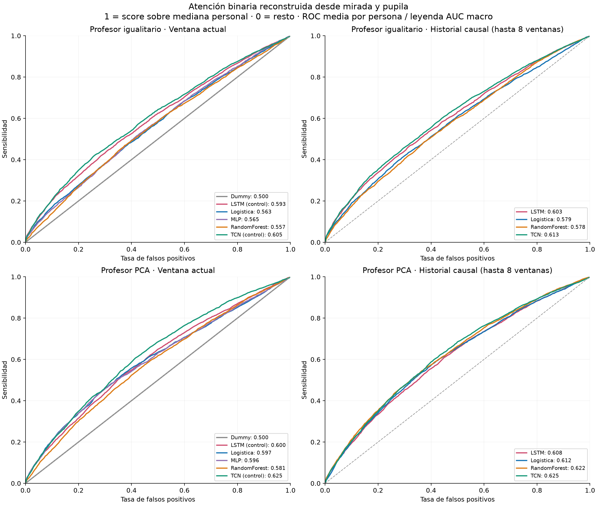

# Atención binaria: profesores reconstruidos — 29-10-2026

1 = atento (score sobre la mediana personal); 0 = no atento (score menor o igual). La etiqueta es relativa y offline por sesión, no una medida externa validada. Se recalcularon componentes desde las características preprocesadas; no se usaron etiquetas o scores anteriores.

## Resultado

25 participantes, 13.498 ventanas válidas. Se omitieron 26 ventanas de train por componentes docentes incompletos. Cada profesor produjo 75 modelos estudiantes, seis bundles docentes (cinco folds y un export full-train) y 202.470 predicciones verificadas. Proporción positiva OOF: 49,95 %. Validation, test y P29 sin evaluar.

| Modelo | Igualitario actual | Igualitario historial | PCA actual | PCA historial |
|---|---:|---:|---:|---:|
| Logistica | 0.5633 | 0.5790 | 0.5975 | 0.6124 |
| RandomForest | 0.5569 | 0.5778 | 0.5813 | 0.6220 |
| MLP | 0.5645 | — | 0.5960 | — |
| TCN | 0.6048 | 0.6127 | 0.6254 | 0.6245 |
| LSTM | 0.5932 | 0.6026 | 0.6005 | 0.6079 |

AUC macro = promedio de AUC por persona tras promediar las dos semillas de redes. Dummy = 0,5000. Para TCN/LSTM, el control actual repite la ventana actual con igual longitud y arquitectura. Historial de hasta ocho ventanas (máximo nueve segundos de señal), sin usar entradas futuras.

## Aporte pareado del historial

| Profesor | Modelo | ΔAUC | IC descriptivo 95 % |
|---|---|---:|---:|
| igualitario | Logistica | +0.0157 | [+0.0005; +0.0311] |
| igualitario | RandomForest | +0.0209 | [+0.0075; +0.0349] |
| igualitario | TCN | +0.0079 | [+0.0001; +0.0159] |
| igualitario | LSTM | +0.0094 | [-0.0018; +0.0213] |
| pca | Logistica | +0.0149 | [+0.0007; +0.0276] |
| pca | RandomForest | +0.0407 | [+0.0272; +0.0548] |
| pca | TCN | -0.0009 | [-0.0066; +0.0047] |
| pca | LSTM | +0.0074 | [+0.0000; +0.0147] |

Intervalos con 2.000 remuestreos pareados de participantes; descriptivos, sin corrección por búsqueda previa. No permiten confirmar una mejora generalizable por sí solos. Las nuevas etiquetas definen tareas distintas de la corrida binaria anterior: no atribuir a los modelos la diferencia de AUC entre tareas.

Los profesores full-train concuerdan en 66,28 % de las etiquetas (kappa 0,3255). Una AUC mayor para un profesor no prueba que sus etiquetas representen mejor atención real. El PCA se reajustó dentro de cada fold; sus etiquetas OOF y las exportadas por el profesor full-train pueden diferir.

## Archivos

- [Predicciones de todos los profesores](predicciones_todos_profesores.csv.gz)
- [Dataset nuevo del profesor igualitario](igualitario/dataset_binario_train.csv.gz)
- [Dataset nuevo del profesor PCA full-train](pca/dataset_binario_train.csv.gz)
- [Etiquetas OOF de PCA](pca/etiquetas_profesor_oof.csv.gz)
- [Resultados igualitario](igualitario/INFORME.md)
- [Resultados PCA](pca/INFORME.md)
- [Auditoría independiente](auditoria_independiente.json)

Reproducir con `scripts/reconstruir_profesor_atencion_binaria.py`; auditar con `scripts/auditar_profesor_binario_reconstruido.py`; graficar con `scripts/graficar_profesores_binarios.py`.