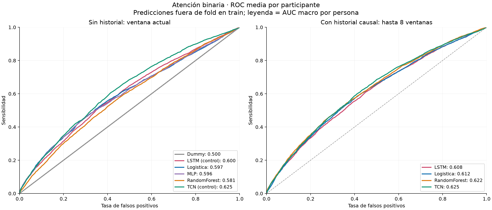
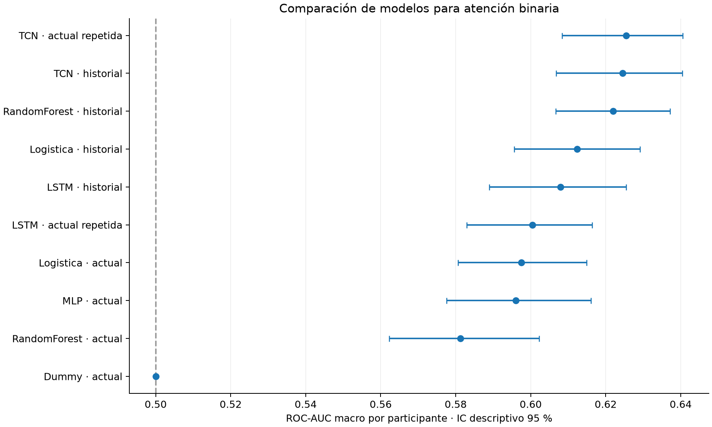

# Profesor binario reconstruido: pca

1 = atento (score > mediana personal); 0 = no atento (score <= mediana); ausentes = NA

Reconstruido desde caracteristicas_multimodales.csv. No se leen etiquetas ni scores antiguos. EEG/GSR predicen etiquetas de mirada/pupila; el profesor PCA se ajusta solo con personas del train de cada fold. Normalización y mediana por persona usan la sesión completa: etiquetado retrospectivo offline, no inferencia online de atención absoluta.

Cinco folds originales por participante, dos semillas en redes, ocho épocas fijas. Validación, test y P29 sin evaluar. Resultados exploratorios. El historial puede usar solo entradas pasadas hasta la ventana actual; la referencia docente offline no es causal.

| Modelo | Entrada | AUC macro | IC descriptivo 95 % |
|---|---|---:|---:|
| TCN | repeat_current | 0.6254 | [0.6083, 0.6405] |
| TCN | history | 0.6245 | [0.6068, 0.6404] |
| RandomForest | history | 0.6220 | [0.6067, 0.6372] |
| Logistica | history | 0.6124 | [0.5956, 0.6292] |
| LSTM | history | 0.6079 | [0.5890, 0.6254] |
| LSTM | repeat_current | 0.6005 | [0.5830, 0.6164] |
| Logistica | current | 0.5975 | [0.5806, 0.6149] |
| MLP_current | current | 0.5960 | [0.5775, 0.6161] |
| RandomForest | current | 0.5813 | [0.5623, 0.6022] |
| Dummy | current | 0.5000 | [0.5000, 0.5000] |

AUC: promedio por persona tras promediar semillas. Intervalos por bootstrap de 25 personas, sin corrección por búsqueda previa. Los datasets exportados usan profesor full-train; las etiquetas OOF de PCA pueden diferir porque el profesor se reajusta dentro de cada fold. Las predicciones OOF siempre usan las etiquetas de su profesor de fold. No se ha validado la interpretación psicológica atento/no atento.

