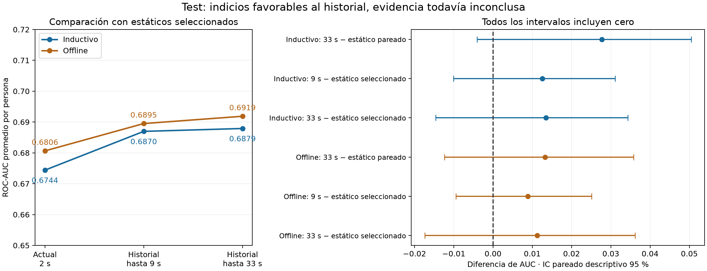

# Test: atención y contraste de temporalidad

## Hipótesis y alcance

Hipótesis de la tesis: los modelos temporales multimodales superan a los estáticos comparables en atención y activación emocional. Fuente: Problema e hipótesis.md, vault del 24-09-2026. Esta corrida aborda atención binaria mediante EEG/GSR y pseudoetiquetas de mirada/pupila. No evalúa activación ni aísla el aporte de la fusión.

Antes de evaluar test se fijó como contraste principal el modelo inductivo de 32 ventanas frente a un control estático de la misma familia y parámetros (HistGradientBoosting, 15 hojas, 300 iteraciones, l2=10, learning_rate=0,05). Se reutilizan los modelos temporales seleccionados solo en train. Los dos controles estáticos pareados se ajustaron solo en train, sin búsqueda adicional. Test y validation ya habían sido consultados en investigaciones anteriores: interpretación exploratoria.

## AUC macro por persona en test

| Estrategia | AUC | IC descriptivo 95 % |
|---|---:|---:|
| inductivo_ctx1 | 0.6744 | [0.6349; 0.7116] |
| inductivo_ctx32 | 0.6879 | [0.6434; 0.7304] |
| inductivo_ctx8 | 0.6870 | [0.6427; 0.7294] |
| inductivo_estatico_pareado | 0.6602 | [0.6139; 0.7043] |
| relativo_offline_ctx1 | 0.6806 | [0.6263; 0.7315] |
| relativo_offline_ctx32 | 0.6919 | [0.6330; 0.7441] |
| relativo_offline_ctx8 | 0.6895 | [0.6354; 0.7380] |
| relativo_offline_estatico_pareado | 0.6786 | [0.6248; 0.7277] |

## Diferencias pareadas

| Temporal | Referencia | ΔAUC | IC 95 % | Personas que mejoran | Interpretación |
|---|---|---:|---:|---:|---|
| inductivo_ctx32 | inductivo_estatico_pareado | +0.0277 | [-0.0041; 0.0505] | 7/8 | inconcluso |
| inductivo_ctx8 | inductivo_ctx1 | +0.0126 | [-0.0100; 0.0311] | 7/8 | inconcluso |
| inductivo_ctx32 | inductivo_ctx1 | +0.0135 | [-0.0146; 0.0344] | 7/8 | inconcluso |
| inductivo_ctx32 | inductivo_ctx8 | +0.0009 | [-0.0058; 0.0066] | 5/8 | inconcluso |
| relativo_offline_ctx32 | relativo_offline_estatico_pareado | +0.0132 | [-0.0124; 0.0358] | 6/8 | inconcluso |
| relativo_offline_ctx8 | relativo_offline_ctx1 | +0.0089 | [-0.0094; 0.0251] | 7/8 | inconcluso |
| relativo_offline_ctx32 | relativo_offline_ctx1 | +0.0112 | [-0.0174; 0.0362] | 5/8 | inconcluso |
| relativo_offline_ctx32 | relativo_offline_ctx8 | +0.0024 | [-0.0090; 0.0134] | 4/8 | inconcluso |

## Conclusión para la hipótesis

Contraste principal: inconcluso; ΔAUC +0.0277, IC [-0.0041; 0.0505].

Un intervalo que incluye cero no confirma superioridad ni demuestra equivalencia o ausencia de efecto. Un intervalo negativo constituye evidencia contraria para esta comparación, no rechazo universal de cualquier arquitectura temporal. Superar AUC 0,70 no prueba la hipótesis, que exige mejora frente al estático. La hipótesis central completa no queda contrastada por esta corrida porque falta el resultado de activación emocional bajo un protocolo comparable.

Los intervalos son bootstrap pareado de ocho participantes, 20.000 remuestreos, semilla 20261029. Son descriptivos, sin ajuste de comparaciones múltiples ni corrección de la búsqueda histórica. No se utilizan ventanas solapadas como observaciones independientes. El contexto contiene ventanas de 2 s con paso de 1 s: ctx1=2 s, ctx8=hasta9 s, ctx32=hasta33 s. Historial de medias/variabilidad, sin modelado explícito del orden. El control pareado conserva familia e hiperparámetros; cambiar la representación temporal cambia su dimensión.

La normalización offline de predictores usa la sesión completa de cada persona y se reporta como secundaria. Incluso el profesor del análisis inductivo usa normalización y umbrales relativos por sesión; son pseudoetiquetas offline y no validación psicológica externa. Se conservan todas las personas y se omiten únicamente las filas sin etiqueta según la regla previa.

## Validation y test, mismos modelos

| Estrategia | Validation | Test |
|---|---:|---:|
| inductivo_ctx1 | 0.6798 | 0.6744 |
| inductivo_ctx32 | 0.6941 | 0.6879 |
| inductivo_ctx8 | 0.6956 | 0.6870 |
| relativo_offline_ctx1 | 0.6832 | 0.6806 |
| relativo_offline_ctx32 | 0.7039 | 0.6919 |
| relativo_offline_ctx8 | 0.7021 | 0.6895 |

## Por participante

| Persona | inductivo_ctx1 | inductivo_ctx32 | inductivo_ctx8 | inductivo_estatico_pareado | relativo_offline_ctx1 | relativo_offline_ctx32 | relativo_offline_ctx8 | relativo_offline_estatico_pareado |
|---|---:|---:|---:|---:|---:|---:|---:|---:|
| P10 | 0.7165 | 0.7353 | 0.7230 | 0.6877 | 0.7151 | 0.7519 | 0.7538 | 0.7235 |
| P11 | 0.7022 | 0.7268 | 0.7270 | 0.6953 | 0.7579 | 0.7688 | 0.7634 | 0.7501 |
| P15 | 0.6564 | 0.6946 | 0.6850 | 0.6537 | 0.6745 | 0.7076 | 0.6828 | 0.6804 |
| P16 | 0.7154 | 0.6416 | 0.6602 | 0.7147 | 0.7493 | 0.6783 | 0.7022 | 0.7371 |
| P37 | 0.5802 | 0.5861 | 0.5803 | 0.5542 | 0.5458 | 0.5450 | 0.5518 | 0.5441 |
| P39 | 0.6052 | 0.6167 | 0.6164 | 0.5716 | 0.5952 | 0.5875 | 0.6018 | 0.5940 |
| P45 | 0.6599 | 0.7156 | 0.7119 | 0.6413 | 0.6335 | 0.7022 | 0.6780 | 0.6329 |
| P5 | 0.7592 | 0.7866 | 0.7920 | 0.7628 | 0.7739 | 0.7936 | 0.7821 | 0.7671 |

## Redacción sugerida para la tesis

En la evaluación de atención sobre ocho participantes de test, incorporar historial temporal produjo una mejora promedio de ROC-AUC frente al control estático de la misma familia y configuración (0,6879 frente a 0,6602; ΔAUC=0,0277). La mejora se observó en siete participantes, pero el intervalo descriptivo pareado del 95 % incluyó cero (−0,0041 a 0,0505). Por tanto, se observaron indicios favorables a la temporalidad, sin evidencia suficientemente concluyente para sostener su superioridad. Este resultado no demuestra ausencia de efecto ni permite rechazar definitivamente la hipótesis alternativa. La hipótesis central, que incluye atención y activación emocional, permanece sin confirmar por esta corrida. La reutilización histórica de test limita la interpretación confirmatoria.

P16 presenta una diferencia de −0,0731 frente al estático pareado; se conserva en el análisis. La mayor mejora individual es P45 (+0,0743). La heterogeneidad explica por qué siete mejoras individuales no bastan para una conclusión robusta sobre la media. No se eliminan participantes ni se cambia el contraste después de ver test.

Se evaluaron 4.024 de las 4.025 ventanas; una ventana de P39 carece de etiqueta docente según la regla previa. La auditoría independiente recalculó 64 AUC por participante, ocho contrastes, las etiquetas y las predicciones de ocho modelos, y verificó familias/parámetros de los controles pareados. Resultado: passed=true.

