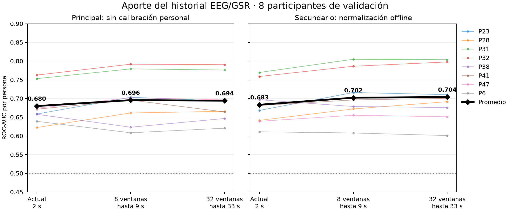

# Evaluación adicional y temporalidad EEG por canal

Selección completa en los 25 participantes de train; profesor PCA, seis modelos y contextos congelados antes de consultar validation. Validation contiene ocho participantes y ya se utilizó en investigaciones previas. Test y P29 no se evalúan.

Los contextos contienen 1, 8 o 32 ventanas de 2 s con paso de 1 s: abarcan hasta 2, 9 o 33 s. El historial incluye la ventana actual y solo ventanas anteriores del mismo segmento, reiniciándose ante huecos. Se agregan medias y desviaciones; no es una red recurrente ni un modelo del orden temporal. Las diferencias comparan procedimientos seleccionados por contexto y pueden reflejar cambios de modelo y dimensionalidad.

La estrategia inductiva es principal; offline es secundaria y normaliza con la sesión completa no etiquetada. El profesor utiliza mirada/pupila y umbrales relativos offline, por lo que los resultados no validan por sí solos un detector psicológico online.

## AUC macro en validation

| Estrategia | Modelo seleccionado en train | AUC | IC descriptivo 95 % |
|---|---|---:|---:|
| inductivo_ctx1 | CatBoost, contexto 1, {'depth': 6, 'l2_leaf_reg': 10.0, 'iterations': 400, 'learning_rate': 0.05} | 0.6798 | [0.6488, 0.7142] |
| inductivo_ctx32 | HistBoost, contexto 32, {'max_leaf_nodes': 15, 'max_iter': 300, 'l2_regularization': 10.0, 'learning_rate': 0.05} | 0.6941 | [0.6571, 0.7349] |
| inductivo_ctx8 | CatBoost, contexto 8, {'depth': 4, 'l2_leaf_reg': 10.0, 'iterations': 400, 'learning_rate': 0.05} | 0.6956 | [0.6536, 0.7389] |
| inductivo_seleccionado | HistBoost, contexto 32, {'max_leaf_nodes': 15, 'max_iter': 300, 'l2_regularization': 10.0, 'learning_rate': 0.05} | 0.6941 | [0.6571, 0.7349] |
| relativo_offline_ctx1 | HistBoost, contexto 1, {'max_leaf_nodes': 7, 'max_iter': 300, 'l2_regularization': 10.0, 'learning_rate': 0.05} | 0.6832 | [0.6483, 0.7208] |
| relativo_offline_ctx32 | CatBoost, contexto 32, {'depth': 4, 'l2_leaf_reg': 10.0, 'iterations': 400, 'learning_rate': 0.05} | 0.7039 | [0.6602, 0.7491] |
| relativo_offline_ctx8 | CatBoost, contexto 8, {'depth': 4, 'l2_leaf_reg': 10.0, 'iterations': 400, 'learning_rate': 0.05} | 0.7021 | [0.6607, 0.7455] |
| relativo_offline_seleccionado | CatBoost, contexto 32, {'depth': 4, 'l2_leaf_reg': 10.0, 'iterations': 400, 'learning_rate': 0.05} | 0.7039 | [0.6602, 0.7491] |

## Diferencia temporal frente a ventana actual

| Estrategia | Contexto | ΔAUC | IC pareado 95 % | Personas que mejoran |
|---|---:|---:|---:|---:|
| inductivo | 8 | +0.0158 | [-0.0059, 0.0337] | 6/8 |
| inductivo | 32 | +0.0143 | [-0.0009, 0.0288] | 5/8 |
| relativo_offline | 8 | +0.0189 | [0.0044, 0.0321] | 6/8 |
| relativo_offline | 32 | +0.0207 | [0.0033, 0.0363] | 6/8 |

Intervalos descriptivos bootstrap de personas, 20.000 muestras, semilla 20261029; no corrigen comparaciones múltiples ni búsqueda acumulada. No se cambia el modelo principal según estos resultados. Los scores CV usados para seleccionar no son una estimación independiente de la configuración ganadora.

## Por persona

| Persona | inductivo_ctx1 | inductivo_ctx32 | inductivo_ctx8 | inductivo_seleccionado | relativo_offline_ctx1 | relativo_offline_ctx32 | relativo_offline_ctx8 | relativo_offline_seleccionado |
|---|---:|---:|---:|---:|---:|---:|---:|---:|
| P23 | 0.6584 | 0.6932 | 0.7032 | 0.6932 | 0.6681 | 0.7102 | 0.7160 | 0.7102 |
| P28 | 0.6223 | 0.6656 | 0.6614 | 0.6656 | 0.6414 | 0.6915 | 0.6720 | 0.6915 |
| P31 | 0.7530 | 0.7761 | 0.7791 | 0.7761 | 0.7696 | 0.8036 | 0.8049 | 0.8036 |
| P32 | 0.7625 | 0.7903 | 0.7917 | 0.7903 | 0.7588 | 0.7976 | 0.7862 | 0.7976 |
| P38 | 0.6576 | 0.6465 | 0.6232 | 0.6465 | 0.6966 | 0.6757 | 0.6786 | 0.6757 |
| P41 | 0.6714 | 0.6640 | 0.6958 | 0.6640 | 0.6812 | 0.7004 | 0.6961 | 0.7004 |
| P47 | 0.6738 | 0.6963 | 0.7020 | 0.6963 | 0.6390 | 0.6511 | 0.6551 | 0.6511 |
| P6 | 0.6390 | 0.6205 | 0.6082 | 0.6205 | 0.6109 | 0.6008 | 0.6078 | 0.6008 |

## Interpretación y cierre

El modelo principal congelado es HistGradientBoosting con 15 hojas, 300 iteraciones, learning_rate=0,05, l2=10 e historial de 32 ventanas: AUC validation 0,6941. El contexto de 8 ventanas obtiene 0,6956 en esta muestra, pero no sustituye al principal: esa decisión se fijó en train.

Frente a ventana actual, el historial inductivo de 32 ventanas mejora +0,0143 AUC, con IC descriptivo pareado [-0,0009; 0,0288]; mejora en cinco de ocho personas. El historial de 8 ventanas mejora +0,0158, IC [-0,0059; 0,0337], en seis de ocho. Ambos intervalos incluyen cero.

El comparador offline elegido es CatBoost, profundidad 4, 400 iteraciones, learning_rate=0,05, l2_leaf_reg=10 e historial de 32 ventanas: AUC 0,7039; diferencia frente a ventana actual +0,0207, IC [0,0033; 0,0363]. El intervalo descriptivo sugiere mejora en esta comparación, sin corrección por multiplicidad ni confirmación independiente. La normalización utiliza la sesión completa.

Se evaluaron 4.654 de las 4.662 ventanas de validation; ocho carecen de etiqueta docente según la regla preexistente (P28: una; P47: una; P6: seis). No se descartaron ventanas por AUC ni por resultado EEG. Las ocho personas se mantienen, con las mismas filas y etiquetas en todas las estrategias.

La auditoría independiente recalculó los 180 archivos CV, verificó la selección hecha solo en train, reconstruyó etiquetas con el profesor final y recargó todos los modelos para comprobar predicciones y AUC. Resultado: passed=true. También pasaron siete pruebas existentes de extracción EEG y representación temporal. No se evaluaron test ni P29.

